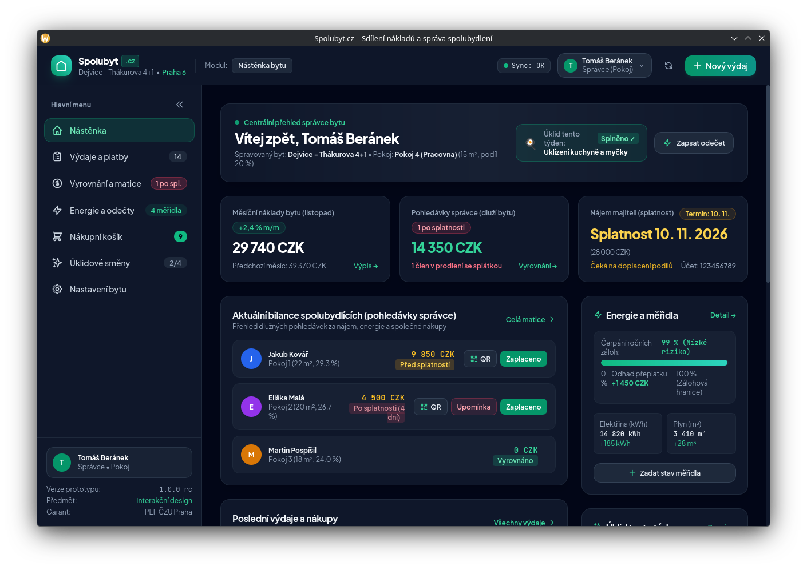

# Spolubyt – Interaktivní prototyp aplikace

> **Semestrální práce z předmětu Interakční design**  
> Katedra informačních technologií, PEF ČZU v Praze  
> Garant předmětu: Ing. Josef Pavlíček, Ph.D.  
> Téma: Sdílení nákladů a správa společné domácnosti

---

## O projektu

Každý, kdo někdy bydlel ve spolubydlení, tenhle scénář dobře zná: nepřehledné excelovské tabulky, ztracené účtenky, lístečky na lednici a nekonečné diskuze ve společné chatovací skupině o tom, kdo naposledy kupoval tablety do myčky, kdo ještě neposlal peníze za plyn a čí je tento týden řada na úklid koupelny. Běžné zahraniční aplikace typu Splitwise sice pomohou rozpočítat jednorázovou večeři, ale už si neporadí s českými QR platbami, zálohami na energie nebo rozpisem služeb.

**Spolubyt** je interaktivní prototyp aplikace, který se snaží všechny tyto provozní i finanční záležitosti sdíleného bytu spojit do jednoho čistého a přehledného rozhraní. 

Aplikace funguje jako webová SPA v prohlížeči a je připravená i pro spuštění jako nativní desktopová aplikace přes Tauri. Doménová data jsou uložená pouze v `localStorage`; aplikace nemá backend ani přihlášení. Přepínání person jen simuluje role a oprávnění. Upomínky, notifikace a platby jsou ukázkové interakce, žádné zprávy ani peníze se neodesílají. Demo používá zmrazený listopad 2026 a úklidový týden 45.

---

## 📸 Náhled aplikace



*Ukázka hlavního dashboardu prototypu (Nástěnka).*

---

## 🚀 Jak aplikaci spustit

Ke spuštění stačí mít nainstalovaný **Node.js 22 nebo novější**; verzi projektu určuje `.nvmrc` (s nvm spusťte `nvm install && nvm use`).

### 1. Spuštění v prohlížeči (nejrychlejší cesta)

```bash
# 1. Přejděte do složky aplikace
cd spolubyt-app

# 2. Nainstalujte závislosti
npm install

# 3. Spusťte vývojový server
npm run dev
```

Aplikace se otevře na adrese: **[http://localhost:5173/](http://localhost:5173/)**

### 2. Spuštění a sestavení desktopové aplikace (přes Tauri)

Pokud máte nainstalovaný Rust a Tauri CLI:

```bash
cd spolubyt-app

# Spuštění ve vývojovém režimu
npm run tauri dev

# Sestavení instalačních balíčků a binárky pro aktuální platformu
npm run tauri build
```

Vygenerované instalační balíčky pro platformu, na které sestavujete, najdete v:

- **macOS DMG:** `src-tauri/target/release/bundle/dmg/`
- **macOS App:** `src-tauri/target/release/bundle/macos/`
- **Windows MSI / NSIS:** `src-tauri/target/release/bundle/msi/` a `src-tauri/target/release/bundle/nsis/`
- **Linux DEB / RPM / AppImage:** `src-tauri/target/release/bundle/deb/`, `src-tauri/target/release/bundle/rpm/` a `src-tauri/target/release/bundle/appimage/`
- **Binárka:** `src-tauri/target/release/spolubyt-app` (na Windows `spolubyt-app.exe`)

### 3. Spuštění testů

Součástí projektu je také sada testů v `tests/e2e-suite.mjs`, které ověřují funkčnost komponent, logiku výpočtů i jednotlivé uživatelské scénáře:

```bash
npm test && npm run build
```

---

## 🧭 Průvodce testováním: Co si v aplikaci vyzkoušet

Aby bylo testování co nejpohodlnější a nebylo nutné se složitě odhlašovat a přihlašovat pod různými účty, je v **pravém horním rohu obrazovky připraven přepínač uživatelů (person)**. 

Díky němu si můžete rozhraní projít z pohledu různých členů domácnosti:

* **Bc. Tomáš Beránek (Správce bytu)**  
  Hlavní nájemce, který má smlouvu s majitelem bytu i dodavateli služeb. Vidí celou finanční bilanci, může odesílat upomínky, párovat došlé platby a jako jediný má přístup k editaci parametrů bytu v Nastavení.
* **Jakub Kovář (Pokoj 1)**  
  Spolubydlící, který má aktuálně dluh 9 850 Kč před splatností (nájem + poplatky). Skvělá role pro otestování rychlé QR platby.
* **Eliška Malá (Pokoj 2)**  
  Spolubydlící s dluhem 4 500 Kč po splatnosti. Umožňuje otestovat, jak systém vizuálně upozorňuje na prodlení a jak fungují upomínky.
* **Martin Pospíšil (Pokoj 3)**  
  Spolubydlící s čistým štítem (0 Kč dluh), na kterém je vidět stav plně vyrovnaného profilu.

### Tipy na konkrétní scénáře k proklikání:

1. **Rychlá platba přes český bankovní QR kód (SPAYD)**  
   Přepněte se na *Jakuba* a v levém menu otevřete sekci **Vyrovnání**. U svého jména klikněte na **Zaplatit (QR kód)**. Otevře se okno s částkou 9 850 Kč, účtem a variabilním symbolem ve formátu SPAYD. Zavřete ho tlačítkem **Hotovo / Zavřít**; samotné zobrazení QR dluh nemění. Pak se přepněte na *Tomáše (Správce)*, u Jakuba klikněte na **Označit jako zaplaceno** a potvrďte formulář přijaté platby. Teprve poté vyskočí konfety a dluh se vynuluje. Formát SPAYD je ukázkový; účet je fiktivní a demo IBAN má záměrně neplatný kontrolní součet. Neposílejte skutečnou platbu.
2. **Převod nákupu z košíku přímo do výdajů**  
   V sekci **Košík** najdete společný nákupní lístek s možností měnit počty kusů (`+` / `-`). Označte některou položku tlačítkem *Koupeno* a následně klikněte na *Převést do výdajů*. Otevře se formulář pro zadání výdaje s již předvyplněným názvem i částkou. Po uložení položka z košíku sama zmizí a objeví se mezi výdaji.
3. **Úklidový rozpis a převzetí směny**
   V sekci **Úklid** je týdenní harmonogram služeb pro čtyři zóny bytu (kuchyň, koupelna, chodba, odpadky). Svou službu můžete označit jako splněnou. Pokud zrovna nemáte čas, můžete u nesplněné směny požádat vybraného spolubydlícího o její převzetí. Když se pak přepnete na daného člověka, uvidí žádost s možností ji přijmout nebo odmítnout. Přijetí převede tuto jednu směnu na osloveného člověka; jeho vlastní směna mu zůstává. Nejde o vzájemnou výměnu dvou směn.
4. **Energie a predikce ročního vyúčtování**  
   V záložce **Energie** je přehled historie odečtů elektřiny, plynu a vody. Můžete přidat nový odečet měřidla a sledovat historii a přírůstek spotřeby. Roční predikce je samostatný demonstrační model s pevně zadanou spotřebou a jednotkovými cenami; nově zapsané odečty ji nemění. Na změnu měsíčních záloh v **Nastavení** naopak reaguje přepočtem očekávaného přeplatku či nedoplatku.
5. **Vyhledávání, filtry a detail účtenky**  
   V sekci **Výdaje** si můžete vyzkoušet okamžité fulltextové vyhledávání, filtrování podle kategorií, plátce nebo měsíce a řazení tabulky kliknutím na záhlaví sloupců. Otevřete detail výdaje s přepínatelnými záložkami **Účtenka / Scan**, **Položky** a **Audit stopa**. Položkový rozpis i autor odpovídají datům konkrétního výdaje. U simulovaných příloh se zobrazují metadata; skutečný soubor není přiložen.
6. **Obnovení výchozích dat**  
   Všechny změny, které v prototypu provedete, se automaticky ukládají do `localStorage` vašeho prohlížeče, takže o ně nepřijdete ani po obnovení stránky. Kdykoliv budete chtít začít znovu od nuly, klikněte na ikonu **Obnovit výchozí testovací data** v horní liště aplikace nebo na tlačítko **Resetovat data prototypu** v sekci Nastavení.

---

## 🛠 Jak je aplikace postavená

Při vývoji byl kladen důraz na čisté a reaktivní uživatelské rozhraní bez nutnosti složitého externího backendu:

* **Frontend:** [Vue 3](https://vuejs.org/) (Composition API, `<script setup>`) s [TypeScriptem](https://www.typescriptlang.org/)
* **Stylování:** [Tailwind CSS](https://tailwindcss.com/) – responzivní layout optimalizovaný pro desktop i menší obrazovky
* **Build nástroj:** [Vite](https://vitejs.dev/) pro rychlý vývoj a optimalizovaný produkční bundle
* **Desktop obal:** [Tauri 2](https://tauri.app/) (Rust) pro možnost distribuce jako samostatná desktopová aplikace
* **Správa stavu:** Centrální reaktivní composable (`useSpolubyt.ts`) propojený s `localStorage`
* **Doplňkové knihovny:** 
  * Lokální SVG ikony a sdílená komponenta `NavIcon.vue`
  * `qrcode` pro generování SPAYD platebních kódů na HTML5 canvas
  * `canvas-confetti` pro hravou vizuální odezvu při zaplacení

---

## 📋 Vazba na zadání semestrální práce

Prototyp v plném rozsahu pokrývá funkční požadavky, analytické use cases i wireframy navržené v úvodních fázích studie:

* **Kompletní navigace podle Task Graphu:** Propojení všech navržených obrazovek (Nástěnka, Výdaje, Detail, Nový výdaj, Vyrovnání, QR platba, Energie, Zápis měřidla, Košík, Úklid, Nastavení).
* **Filtrování a řazení v reálném čase:** Okamžitá odezva bez nutnosti načítat stránku znovu, s dynamickým přepočtem souhrnů.
* **Detail položky s přepínáním záložek:** Dvousloupcové okno s položkovým rozpadem, dokladem a historií změn.
* **Interaktivní košík:** Přidávání položek, změna počtu kusů v reálném čase a přímý převod do výdajů.
* **Prevence chyb a konfirmační dialogy:** Zabezpečení nevratných akcí (mazání výdajů, reset dat, vysypání košíku) s podporou klávesy `Escape`.
* **Zpětná vazba pro uživatele:** Kontextové toast notifikace, vizuální odznaky stavu úklidu i platební morálky.
* **Přístupnost a čistota kódu:** Sémantické HTML, viditelné focus stavy, přístupné modály a responzivní chování.

---

## 📄 Licence a zapojení do vývoje

- **Licence:** Tento projekt je licencován pod licencí MIT – podrobnosti naleznete v souboru [LICENSE](LICENSE).
- **Kodex chování:** [CODE_OF_CONDUCT.md](CODE_OF_CONDUCT.md)
- **Jak přispět:** [CONTRIBUTING.md](CONTRIBUTING.md)

---

*Vytvořeno v rámci studia na Provozně ekonomické fakultě ČZU v Praze.*


Verze 2.0.0 používá nový atomický formát `spolubyt_hifi_v2_state` v localStorage. Data staršího prototypu se nenačítají; první spuštění otevře opravený demo scénář. Fonty i ikony jsou součástí aplikace a za běhu nevyžadují síť. Datum formulářů je zmrazené na 12. 11. 2026.

Release workflow kontroluje shodu tagu s verzemi, spouští testy a build a vytváří koncept vydání. Přikládá frontendové/fontové notices a výstup cargo-about pro Rust závislosti. Instalační balíčky se zde nepodepisují.
